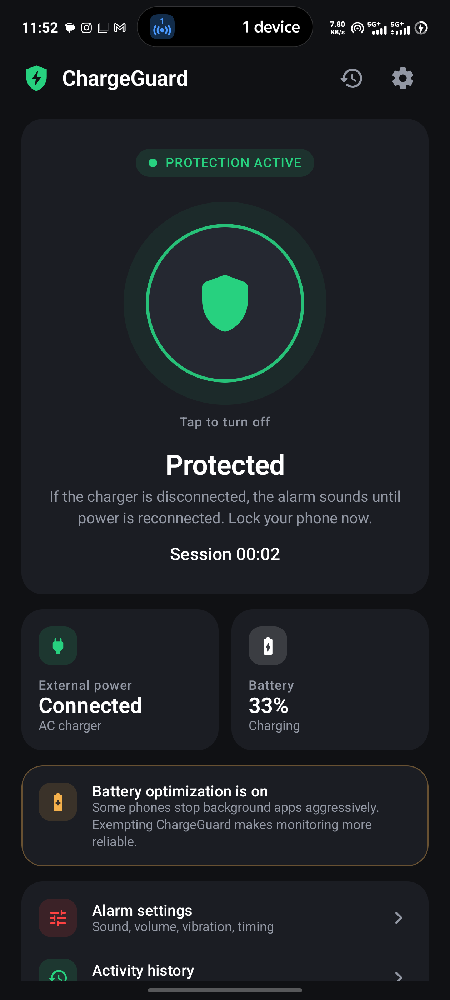
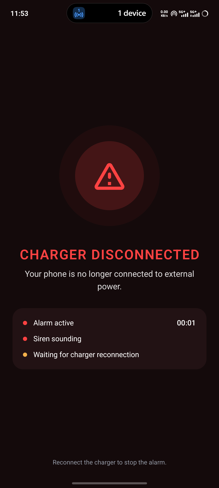
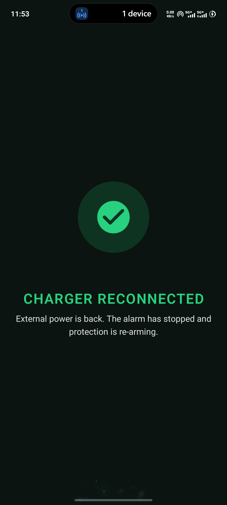

# ChargeGuard

ChargeGuard sounds a loud alarm if your Android phone is unplugged from its charger while
protection is on. The alarm keeps going (siren, vibration, alarm notification, and a full-screen
alarm when Android allows it) until external power is reconnected. Then it stops and re-arms
automatically.

* Kotlin, Jetpack Compose, Material 3, MVVM, Hilt, Coroutines/StateFlow, DataStore, Room
* Foreground service (`mediaPlayback`), dynamic power receiver, sticky `ACTION_BATTERY_CHANGED`
* Offline. No account, no backend, no ads, no analytics, no location/contacts/camera/microphone.
* Min SDK 26 (Android 8.0), target/compile SDK 36

<p align="center">
  
  
  
</p>

**Download:** get `ChargeGuard-1.0.0-release.apk` from the [Releases](https://github.com/Tomatoo0-90/ChargeGuard/releases) page
(Android 8.0+). A full project report with a pitch guide is in
[docs/ChargeGuard_Project_Report.pdf](docs/ChargeGuard_Project_Report.pdf).

> ChargeGuard does **not** claim to prevent power-off, Force stop, reboot or manufacturer task
> killing. When monitoring isn't running, the app says "Monitoring unavailable" and never claims
> protection. See [docs/KNOWN_LIMITATIONS.md](docs/KNOWN_LIMITATIONS.md).

## Project layout

```
D:\ChargeGuard
├─ app/                      Android application module
│  └─ src/main/java/com/chargeguard/
│     ├─ MainActivity.kt, ChargeGuardApp.kt
│     ├─ core/        di, permissions, notifications, common (wake locks, formatting)
│     ├─ data/        charging (sticky battery + receiver), settings (DataStore),
│     │               history (Room), security (PIN verifier, Keystore HMAC)
│     ├─ domain/      model, repository interfaces, protection (state machine + manager)
│     ├─ receiver/    ChargingReceiver (dynamic), BootReceiver
│     ├─ service/     ProtectionService (foreground monitoring)
│     ├─ alarm/       AlarmController, VibrationController, AlarmCoordinator
│     └─ ui/          splash, onboarding, home, alarm, settings, history, components, navigation, theme
│  └─ src/test/       JVM unit tests (state machine, manager, charging parsing, settings, PIN)
│  └─ src/androidTest/ instrumented tests (Room DAO, sticky battery read, alarm player, vibration)
├─ docs/                     ARCHITECTURE.md, KNOWN_LIMITATIONS.md, TESTING.md
├─ scripts/build.ps1         build helper using the portable toolchain
└─ build-output/             built APKs
```

## Building

### Option A: Android Studio
Open `D:\ChargeGuard` in Android Studio (Ladybug or newer, with JDK 17+), let Gradle sync, then
run the `app` configuration.

### Option B: command line (portable toolchain, as used for this delivery)
The toolchain was installed portably in `D:\AndroidDev` (JDK 17, Android SDK, Gradle cache):

```powershell
cd D:\ChargeGuard
powershell -ExecutionPolicy Bypass -File scripts\build.ps1                       # unit tests + debug APK
powershell -ExecutionPolicy Bypass -File scripts\build.ps1 lintDebug             # Android Lint
powershell -ExecutionPolicy Bypass -File scripts\build.ps1 connectedDebugAndroidTest   # on a USB-connected phone
powershell -ExecutionPolicy Bypass -File scripts\build.ps1 assembleRelease       # release APK
```

Outputs (copies in `build-output/`):
* `ChargeGuard-1.0.0-debug.apk`: package `com.chargeguard.debug` (can be installed next to release)
* `ChargeGuard-1.0.0-release.apk`: package `com.chargeguard`, R8-minified, signed with the local release key

### Release signing
`app/build.gradle.kts` signs release builds when `keystore.properties` exists in the project root:

```properties
storeFile=keystore/chargeguard-release.jks
storePassword=...
keyAlias=chargeguard
keyPassword=...
```

A key was generated for this project (`keystore/chargeguard-release.jks`, certificate SHA-256
`66:48:89:9C:42:CC:22:A9:27:93:2D:DC:B5:2A:CF:98:09:E3:69:4A:E2:4B:49:CA:D2:01:CE:95:23:28:A9:2C`).
Both `keystore/` and `keystore.properties` are git-ignored. **Back up both files somewhere safe.** Without it
you can't publish updates signed with the same key. Without `keystore.properties`,
`assembleRelease` produces an unsigned APK.

### Install on a phone
```powershell
D:\AndroidDev\sdk\platform-tools\adb.exe install -r build-output\ChargeGuard-1.0.0-debug.apk
```

## Dependency versions
Pinned to a mutually compatible, stable set: **AGP 8.13.2, Gradle 8.14.3, Kotlin 2.2.21, KSP
2.2.21-2.0.5, Hilt 2.57.2, Compose BOM 2025.10.01, Navigation 2.9.5, Lifecycle 2.9.4, DataStore
1.1.7, Room 2.8.3**. Newer major lines exist (AGP 9.x, Kotlin 2.4). AGP 9 changes how Kotlin is
applied to Android modules, so moving to it should be a separate, tested migration rather than a
version bump. Lint's "newer version available" checks are disabled for that reason.

## Using ChargeGuard
1. Open the app and go through onboarding (allow notifications for the best experience).
2. Connect the charger and tap the shield. The status changes to **Protection active**.
3. Lock the phone. If the cable is pulled, the alarm starts after the confirmation window (default 1 s).
4. Plug the charger back in: the alarm stops, "Charger reconnected" shows, and protection re-arms.
5. To turn protection off, open the app and tap the shield (owner PIN required if you set one).

Recommended: Settings → Permissions → set battery optimization to *Unrestricted*, and allow
full-screen alarms.

## Tests
Current status: **77/77 JVM unit tests, 7/7 instrumented tests, lint clean, 25 device checks passed
on a vivo iQOO (Android 16), including a physical cable pull.** Details and the remaining manual
tests are in [docs/TESTING.md](docs/TESTING.md).

* JVM unit tests: `scripts\build.ps1 testDebugUnitTest`. Report at
  `app/build/reports/tests/testDebugUnitTest/index.html`.
* Instrumented tests (phone connected): `scripts\build.ps1 connectedDebugAndroidTest`
  (plays a short, very quiet siren).
* Manual device checklist and results: [docs/TESTING.md](docs/TESTING.md).

## Documentation
* [docs/ARCHITECTURE.md](docs/ARCHITECTURE.md): layers, state machine, service lifecycle, alarm engine
* [docs/KNOWN_LIMITATIONS.md](docs/KNOWN_LIMITATIONS.md): what Android does not allow, and how the app reacts
* [docs/TESTING.md](docs/TESTING.md): automated test inventory and physical-device test results

## Credits
* **Developer:** Anish Verma, B.Tech Data Science, Rungta University, Bhilai ([@Tomatoo0-90](https://github.com/Tomatoo0-90))
* **Mentor / Technical Guide:** Mr. Satyaprakash Sethy ([@SATYAPRAKASHSETHY](https://github.com/SATYAPRAKASHSETHY))
* Built with AI-assisted development (Claude) under the developer's direction; every test result in
  `docs/TESTING.md` was actually executed on a real device.
* Alarm sounds are original, synthesised with a small Python script; no third-party audio.
